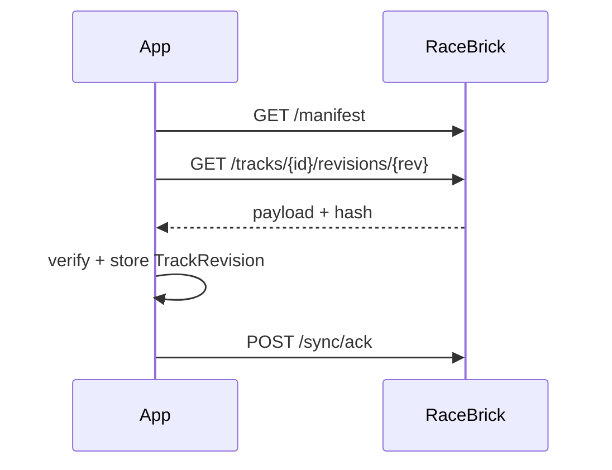
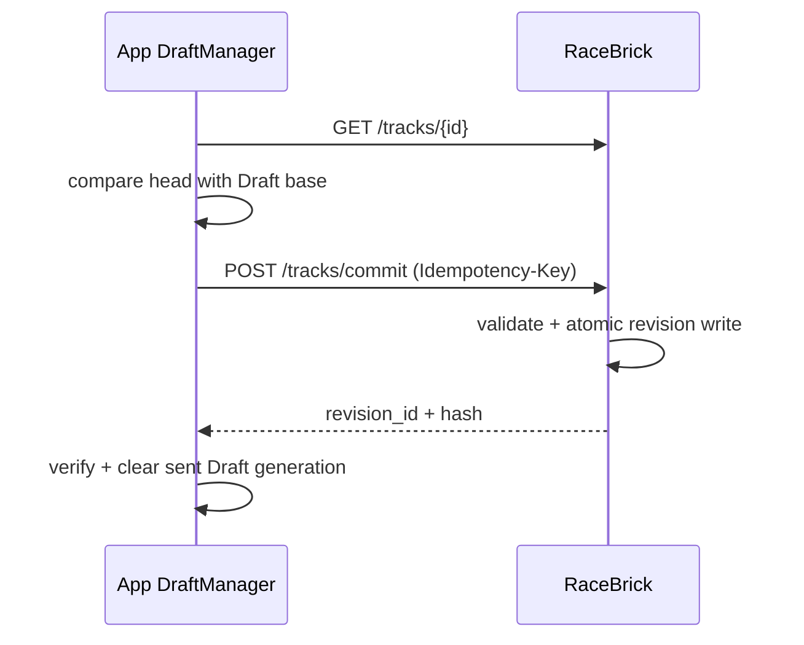
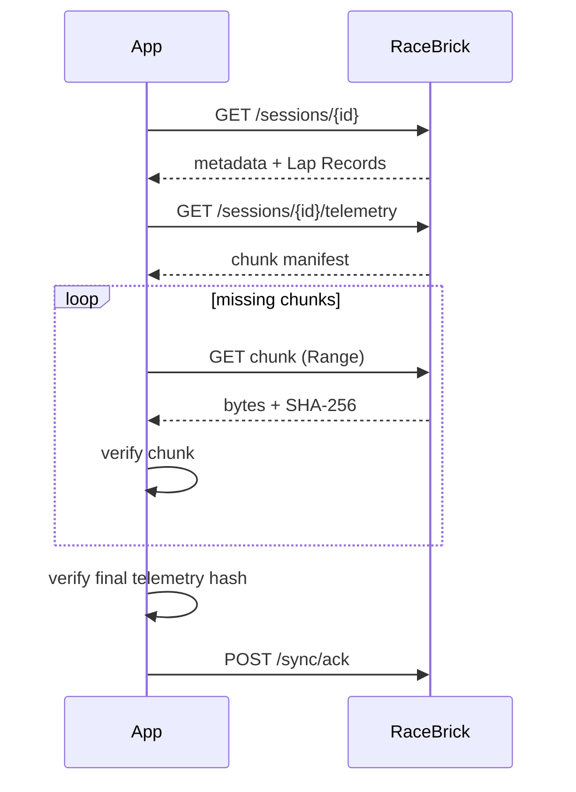

# RaceBrick API v2 — Device and Cloud Contract

- Status: **Phase 1 draft for review**
- Companion to [THREE_TIER_ARCHITECTURE.md](THREE_TIER_ARCHITECTURE.md)
- No v1 endpoint is removed in Phase 1. V2 is additive until migration is complete.

---

## 1. Common Conventions

### 1.1 Roles

- **Device API**: RaceBrick local HTTP endpoint, reached over the device AP or the same LAN.
- **Cloud API**: account and manual cloud-sync API, reached over HTTPS.
- **App**: the only coordinator between them.

### 1.2 Encoding

- Metadata: UTF-8 JSON.
- Track payload hashes: canonical JSON per RFC 8785/JCS or the shared implementation agreed in Phase 2.
- Raw telemetry: binary chunks.
- Timestamps: UTC ISO-8601 for JSON, Unix milliseconds/seconds only where explicitly stated.
- UUIDs: lowercase canonical UUID strings.

### 1.3 Device headers

```http
Authorization: Bearer <device_pair_token>
X-RaceBrick-Protocol: 2
X-Client-Id: <android-install-id>
Idempotency-Key: <uuid>          # required on mutations
If-Match: <revision_id>          # required on Track commit/delete
```

### 1.4 Cloud headers

```http
Authorization: Bearer <account_token>
Idempotency-Key: <uuid>          # required on mutations
If-Match: <revision_id>          # required on Track writes
```

### 1.5 Error envelope

```json
{
  "error": {
    "code": "version_conflict",
    "message": "base revision is stale",
    "details": {
      "current_revision_id": "…",
      "current_version": 12,
      "current_content_hash": "…"
    }
  }
}
```

Error codes:

| HTTP | Code | Meaning |
|---|---|---|
| 400 | `invalid_payload` | validation failure |
| 401 | `unauthenticated` | missing/expired token |
| 403 | `forbidden` | wrong account/device owner |
| 404 | `not_found` | object missing |
| 409 | `version_conflict` | stale base revision |
| 409 | `race_active` | device is recording/racing |
| 409 | `object_exists` | immutable object/hash conflict |
| 409 | `track_history_full` | device revision history cannot accept commit |
| 412 | `precondition_failed` | If-Match mismatch |
| 413 | `chunk_too_large` | chunk above limit |
| 416 | `invalid_range` | resumable range invalid |
| 429 | `rate_limited` | retry after delay |
| 5xx | `server_error` | retry with backoff |

### 1.6 Idempotency

- Every mutation requires `Idempotency-Key`.
- Reusing the key returns the original result; it must not create a duplicate revision.
- Objects with immutable content (Session/Lap/Telemetry chunk) are also idempotent by object ID + SHA-256.
- A same ID with a different hash returns `409 object_exists`, never an overwrite.

### 1.7 Limits

- Manifest response target: less than 1 MiB.
- Telemetry chunk: 64 KiB logical chunks, maximum upload size 256 KiB.
- Track payload: maximum 512 KiB.
- Device transfer must refuse while a race is active.

---

## 2. Device Discovery And Pairing

### 2.1 Discovery

Existing UDP discovery may advertise:

```json
{
  "type": "racebrick",
  "protocol": 2,
  "device_id": "esp32s3-32D0A8",
  "name": "RaceBrick-D0A9",
  "ip": "192.168.1.42",
  "port": 80,
  "paired": true
}
```

Discovery is read-only and reveals no session data.

### 2.2 Pairing

The device displays a short one-time code in its UI.

`POST /api/v2/pair`

```json
{
  "code": "482913",
  "client_id": "android-install-uuid",
  "client_name": "Pixel 9"
}
```

Response:

```json
{
  "device_id": "esp32s3-32D0A8",
  "token": "device-scoped-token",
  "protocol": 2,
  "expires_at": "2027-11-26T00:00:00Z"
}
```

Rules:

- The code expires after a short window and after a small number of attempts.
- The token is scoped to the device and stored in Android Keystore.
- The token can be revoked from the device UI.
- Manifest and all sync endpoints require the token.
- BLE may be used to help discover/pair, but is not required for large transfers.

---

## 3. Device Manifest

`GET /api/v2/manifest`

Read-only. No business data is changed.

```json
{
  "protocol": 2,
  "device_id": "esp32s3-32D0A8",
  "firmware": "0.9.71",
  "generated_at": "2026-11-26T10:00:00Z",
  "dataset_generation": 42,
  "tracks": [
    {
      "track_id": "4d53f65d-31fa-4a54-89f2-80a92f8a9f60",
      "name": "Shanghai Kart",
      "version": 7,
      "revision_id": "c6b4e2d0-66e4-4d4b-a0f1-06f27f6e4c12",
      "parent_revision_id": "2c9d0a13-22a4-4ca5-90b8-94dc4d09e9af",
      "content_hash": "sha256:…",
      "updated_at": "2026-11-26T09:54:00Z",
      "deleted": false
    }
  ],
  "sessions": [
    {
      "session_id": "8f0c6b46-2b89-4bf5-aa72-70eae5aa5d41",
      "track_id": "4d53f65d-31fa-4a54-89f2-80a92f8a9f60",
      "track_revision_id": "c6b4e2d0-66e4-4d4b-a0f1-06f27f6e4c12",
      "track_version": 7,
      "start_time": "2026-11-26T09:12:00Z",
      "end_time": "2026-11-26T09:34:00Z",
      "session_type": "race",
      "total_laps": 12,
      "best_lap_time_ms": 42318,
      "metadata_hash": "sha256:…",
      "laps_hash": "sha256:…",
      "telemetry": {
        "available": true,
        "format_version": 3,
        "sample_rate_hz": 25,
        "sample_count": 33000,
        "size_bytes": 660000,
        "sha256": "sha256:…",
        "chunk_count": 11
      },
      "deleted": false
    }
  ]
}
```

Manifest rules:

- Tracks include only metadata; geometry is fetched by revision.
- Sessions include metadata and telemetry availability/size; raw chunks are fetched separately.
- Old Logs are not present; legacy `histrec` records are deleted with no compatibility path.
- Device must not include full telemetry in the manifest.

---

## 4. Device Track API

### 4.1 Read current Track or revision

```http
GET /api/v2/tracks/{track_id}
GET /api/v2/tracks/{track_id}/revisions/{revision_id}
GET /api/v2/tracks/{track_id}/revisions?limit=4
```

Current Track response:

```json
{
  "track_id": "…",
  "version": 7,
  "revision_id": "…",
  "parent_revision_id": "…",
  "content_hash": "sha256:…",
  "created_at": "2026-10-01T10:00:00Z",
  "updated_at": "2026-11-26T09:54:00Z",
  "payload": {
    "name": "Shanghai Kart",
    "location": {"label": "Shanghai", "lat": 31.23, "lon": 121.47},
    "layout": {"points": [], "closed": true, "length_m": 1200.0},
    "track_geometry": {"type": "centerline_width", "width_m": 7.0, "points": []},
    "start_finish_line": {"f": 0.12, "offset_m": 0.0, "width_m": 8.0, "heading": 1.2},
    "sector_lines": [
      {"index": 1, "f": 0.33, "start": [0.1, 0.2], "end": [0.2, 0.3]}
    ]
  }
}
```

Legacy tracks may have `location=null`, `track_geometry={type:"legacy"}`, and sector entries with fractions only.

### 4.2 Batch commit

`POST /api/v2/tracks/commit`

```json
{
  "track_id": "…",
  "base_revision_id": "…",
  "client_commit_id": "…",
  "payload": {
    "name": "Shanghai Kart",
    "location": {},
    "layout": {},
    "track_geometry": {},
    "start_finish_line": {},
    "sector_lines": []
  },
  "content_hash": "sha256:…"
}
```

Rules:

- New Track: `base_revision_id` is `null`, `track_id` is a new UUID.
- Existing Track: `base_revision_id` must equal the current head.
- Device validates geometry, ranges, sector ordering, and name.
- Device verifies `content_hash`.
- Device rejects while racing.
- Device commits one new revision atomically.
- Device retains the previous revision according to its retention policy.
- If the revision history is full, return `409 track_history_full`; do not silently evict.
- The request is idempotent by `client_commit_id`.

Response:

```json
{
  "track_id": "…",
  "version": 8,
  "revision_id": "…",
  "parent_revision_id": "…",
  "content_hash": "sha256:…",
  "committed_at": "2026-11-26T10:02:00Z"
}
```

Conflict response includes current head so the app can resolve:

```json
{
  "error": {
    "code": "version_conflict",
    "message": "base revision is stale",
    "details": {
      "current_version": 8,
      "current_revision_id": "…",
      "current_content_hash": "sha256:…",
      "current_payload": {}
    }
  }
}
```

### 4.3 Delete Track

Deletion requires explicit user authorization and an `If-Match` head.

`DELETE /api/v2/tracks/{track_id}`

- Rejected while racing.
- Creates a Track tombstone, not a Session cascade.
- Sessions retain their `track_id`/`track_revision_id` and remain readable.
- App must never delete Sessions/Laps as a side effect.

---

## 5. Device Session, Lap, And Telemetry API

All endpoints are read-only.

### 5.1 Session metadata + Lap Records

```http
GET /api/v2/sessions/{session_id}
```

Response:

```json
{
  "session_id": "…",
  "track_id": "…",
  "track_revision_id": "…",
  "track_version": 7,
  "device_id": "esp32s3-32D0A8",
  "start_time": "2026-11-26T09:12:00Z",
  "end_time": "2026-11-26T09:34:00Z",
  "session_type": "race",
  "total_laps": 12,
  "best_lap_time_ms": 42318,
  "metadata": {
    "vehicle": "DS Karting 200cc",
    "firmware": "0.9.71",
    "time_source": "gnss_utc"
  },
  "laps": [
    {
      "lap_id": "…",
      "lap_number": 1,
      "lap_time_ms": 43120,
      "sector_times_ms": [14500, 13800, 14820],
      "start_timestamp": "2026-11-26T09:13:00Z",
      "end_timestamp": "2026-11-26T09:13:43.120Z",
      "best_lap": false,
      "telemetry_reference": {
        "first_sample": 250,
        "last_sample": 3600,
        "chunk_ids": ["…"]
      },
      "content_hash": "sha256:…"
    }
  ],
  "deleted": false
}
```

Legacy sessions return empty `sector_times_ms` and a `legacy: true` marker; values are not fabricated.

### 5.2 Telemetry manifest

```http
GET /api/v2/sessions/{session_id}/telemetry
```

```json
{
  "session_id": "…",
  "format_version": 3,
  "sample_rate_hz": 25,
  "sample_count": 33000,
  "size_bytes": 660000,
  "sha256": "sha256:…",
  "chunks": [
    {
      "chunk_id": "…",
      "seq": 0,
      "offset": 0,
      "size": 65536,
      "sha256": "sha256:…"
    }
  ]
}
```

### 5.3 Telemetry chunk download

```http
GET /api/v2/sessions/{session_id}/telemetry/chunks/{chunk_id}
Range: bytes=0-262143
```

Response:

```http
200 OK / 206 Partial Content
Content-Type: application/octet-stream
Content-Length: 65536
ETag: "sha256:…"
X-Chunk-SHA256: sha256:…
Accept-Ranges: bytes
```

Rules:

- The app verifies each chunk hash.
- Interrupted chunks resume with `Range`.
- The app verifies the final telemetry SHA-256 before acknowledging.
- Raw telemetry is immutable; there is no upload/write endpoint.

### 5.4 Export

`GET /api/v2/sessions/{session_id}/export.csv`

- Read-only compatibility export.
- Includes timestamp, lap, elapsed, latitude, longitude, speed, and available quality fields.
- The app may also generate exports locally from raw chunks.

### 5.5 No session/lap mutations

The device must not expose:

- edit Session;
- delete Session from the app;
- edit Lap;
- delete Lap from the app;
- upload raw telemetry.

Deletion is an explicit device-side operation that produces a tombstone.

---

## 6. Device Acknowledgment

`POST /api/v2/sync/ack`

```json
{
  "client_id": "android-install-uuid",
  "objects": [
    {"type": "track", "id": "…", "revision_id": "…", "hash": "sha256:…"},
    {"type": "session", "id": "…", "hash": "sha256:…"},
    {"type": "telemetry", "id": "…", "chunk_ids": ["…"], "hash": "sha256:…"}
  ]
}
```

The device records successful delivery for diagnostics. It does not edit the immutable objects.

---

## 7. Cloud API v2

Base URL: `https://racebrick.tfworks.cn/api/v2`

Existing `/api/platform`, `/api/phone/v1`, and disabled `/api/device/v1` remain until migration.

### 7.1 Authentication

| Method | Path | Purpose |
|---|---|---|
| POST | `/auth/register` | register |
| POST | `/auth/login` | obtain account token |
| POST | `/auth/refresh` | refresh/renew |
| POST | `/auth/logout` | revoke |
| GET | `/me` | current user |

### 7.2 Devices

| Method | Path | Purpose |
|---|---|---|
| GET | `/devices` | owned devices |
| POST | `/devices/bind` | bind device ID |
| GET | `/devices/{device_id}` | device status |
| GET | `/devices/{device_id}/manifest` | latest cloud manifest |
| POST | `/devices/{device_id}/tombstones` | relay explicit device deletion event |

Cloud object ownership is enforced for every request. No cross-account reads.

### 7.3 Track revisions

| Method | Path | Purpose |
|---|---|---|
| GET | `/tracks/{track_id}` | current head |
| GET | `/tracks/{track_id}/revisions` | revision history |
| GET | `/tracks/{track_id}/revisions/{revision_id}` | exact revision |
| PUT | `/tracks/{track_id}/revisions/{revision_id}` | upload committed revision |
| POST | `/tracks/{track_id}/restore` | restore an old revision as new head |
| DELETE | `/tracks/{track_id}` | explicit tombstone |

Upload revision:

```json
{
  "base_revision_id": "…",
  "version": 8,
  "parent_revision_id": "…",
  "payload": {},
  "content_hash": "sha256:…",
  "created_by": "app"
}
```

Rules:

- `If-Match`/`base_revision_id` must match cloud head.
- Divergent head returns `409 version_conflict` with the cloud head and hash.
- Uncommitted app Drafts are rejected unless the app marks them committed and includes the device commit result.
- A revision already stored with the same hash is idempotent; a different hash for the same revision ID returns `409`.

Restore:

```json
{
  "source_revision_id": "…",
  "idempotency_key": "…"
}
```

- Creates a new head revision whose parent is the current head.
- Does not rewrite history.
- Does not touch Sessions.

### 7.4 Sessions, laps, and telemetry

| Method | Path | Purpose |
|---|---|---|
| GET | `/sessions/{session_id}` | metadata + laps |
| PUT | `/sessions/{session_id}` | upload immutable metadata |
| PUT | `/sessions/{session_id}/laps` | upload immutable Lap Records batch |
| GET | `/sessions/{session_id}/telemetry` | telemetry manifest |
| PUT | `/sessions/{session_id}/telemetry/chunks/{chunk_id}` | upload chunk |
| GET | `/sessions/{session_id}/telemetry/chunks/{chunk_id}` | download chunk |

Rules:

- Session/Lap/Telemetry uploads are manual cloud backup only; no client may alter an existing original.
- Re-upload with the same hash is idempotent.
- Same ID + different hash returns `409 object_exists`.
- No normal app deletion of Sessions/Laps.
- Device-originated tombstones are relayed separately and marked with origin `device`.

### 7.5 Manual cloud sync

Cloud upload and restore are user-triggered only. There is no background scheduler, automatic upload, automatic download, or automatic overwrite.

| Method | Path | Purpose |
|---|---|---|
| POST | `/cloud-sync/upload` | user-triggered incremental upload |
| GET | `/cloud-sync/status` | last upload/restore, queued objects, last error |
| GET | `/cloud-sync/manifest` | objects/chunks the cloud currently has |
| POST | `/cloud-sync/restore/preview` | dry-run restore summary |
| POST | `/cloud-sync/restore` | explicit restore after confirmation |
| GET | `/cloud-sync/jobs` | job list/status |
| GET | `/cloud-sync/jobs/{job_id}` | job detail |

Status example:

```json
{
  "last_successful_upload_at": "2026-11-20T10:00:00Z",
  "last_restore_at": null,
  "pending_object_count": 14,
  "pending_bytes": 18234123,
  "last_error": null
}
```

Restore preview:

```json
{
  "scope": "all",
  "tracks": 5,
  "sessions": 7,
  "laps": 61,
  "telemetry_bytes": 18234123,
  "conflicts": [],
  "replaces_local": true
}
```

Restore rules:

- The app must show the preview and obtain explicit confirmation before replacing local data.
- The app should keep a local rollback snapshot until the restored state is verified.
- Restore never writes to RaceBrick.
- Restoring a Track revision creates a new Track head locally; pushing it to RaceBrick still uses Draft/commit.
- There is no seven-day reminder and no automatic restore/upload in the current scope.

### 7.6 Cloud manifest

`GET /devices/{device_id}/manifest` returns the same object inventory shape as the device manifest, plus cloud revision heads.

`GET /sync/tasks` and `POST /sync/ack` support persistent queue diagnostics/acknowledgment.

### 7.7 Leaderboard

Manual only:

| Method | Path | Purpose |
|---|---|---|
| POST | `/leaderboard/entries` | submit selected lap |
| GET | `/leaderboard/tracks/{track_id}` | public rankings |

Submission includes:

- `track_id`
- `track_revision_id`
- `session_id`
- `lap_id`
- `vehicle_class`
- `lap_time_ms`
- `sector_times_ms`

Public payload must not include raw telemetry or private backup data. Server validates ownership, immutable hashes, track revision, lap time, and sector times before accepting.

---

## 8. Transfer Sequences

### 8.1 Track import



### 8.2 Track commit



### 8.3 Session metadata and raw telemetry



---

## 9. Migration Notes

- V1 endpoints remain during migration.
- No v1 full-snapshot replacement may be used by the new app.
- Device v2 records retain legacy slot/epoch fields only for one-time migration:
  - `legacy_slot`
  - `legacy_epoch_id`
- Existing Sessions get deterministic UUIDs during device migration:
  `uuidv5(device_id, "session:" + legacy_epoch_id + ":" + slot + ":" + content_hash)`.
- Existing Tracks get generated `track_id` UUIDs and revision `v1`; the original slot is retained as `legacy_slot`.
- Legacy `histrec` / Old Logs are deleted from device, app, and cloud. No conversion, export, or compatibility UI is retained.
- The old device log-store region is reclaimed or reserved after deletion.

---

## 10. Security And Integrity Requirements

- Pairing tokens are stored in Android Keystore; account tokens are never logged.
- All cloud object requests enforce owner/device scope.
- Telemetry and Track payloads are content-hashed before acknowledgment.
- No silent overwrite on version mismatch.
- No cascade deletion of immutable Sessions when a Track is deleted.
- Transfer writes are atomic: temporary file/chunk + verify + rename.
- Device commit is atomic across header/index/data slot.
- App preserves Drafts across restart, network loss, and commit failure.
- Manual cloud-sync tasks survive app restart.
- Idempotency keys are retained long enough to cover retry windows.
- Request bodies and raw telemetry are not written to logs.
