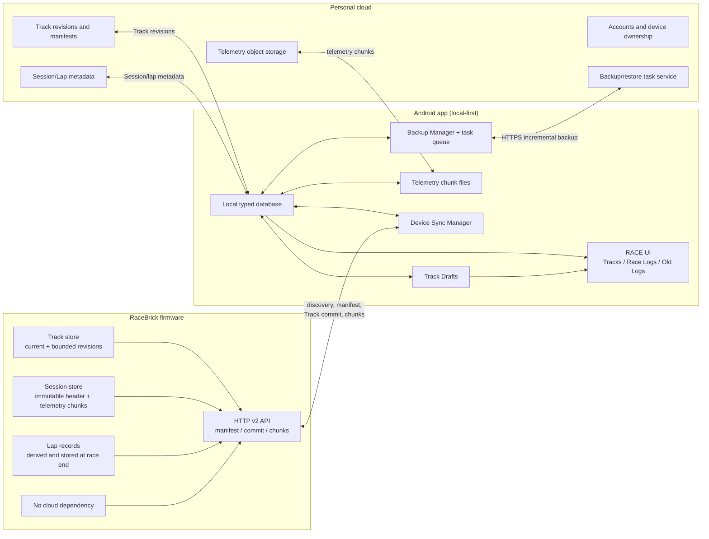
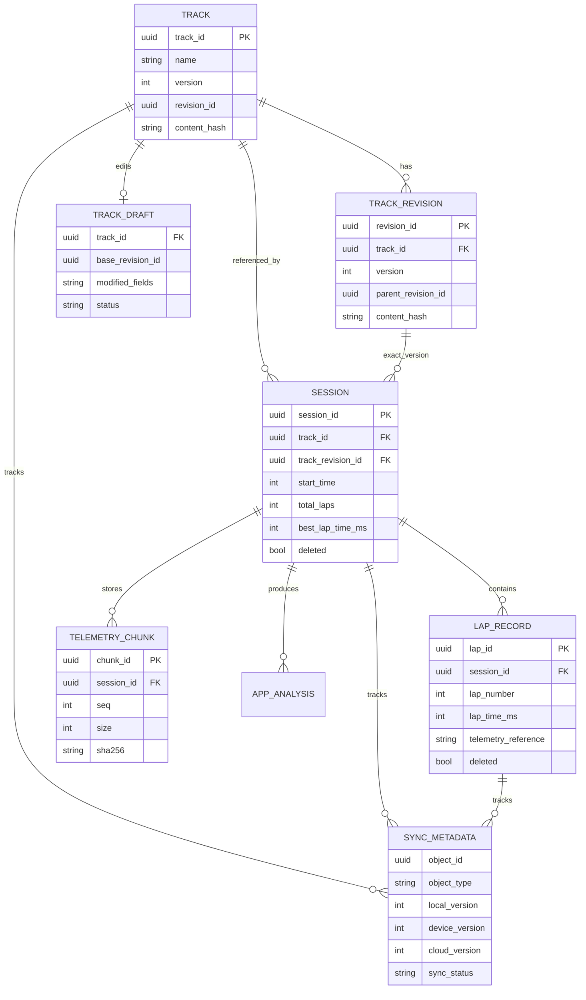
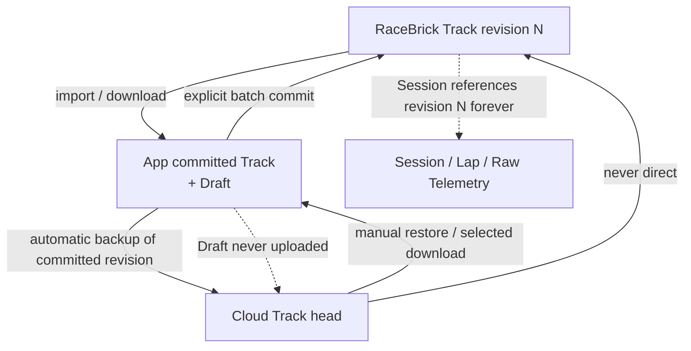
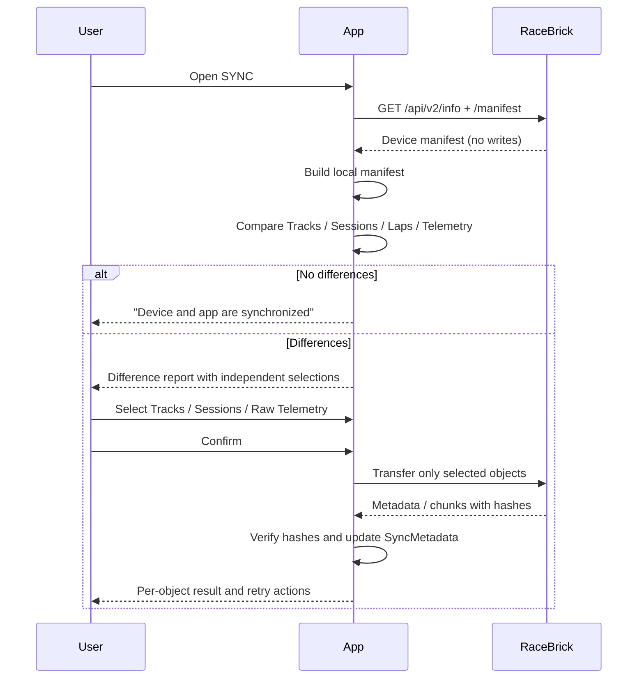
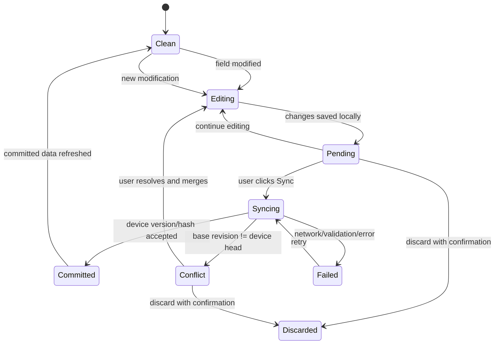
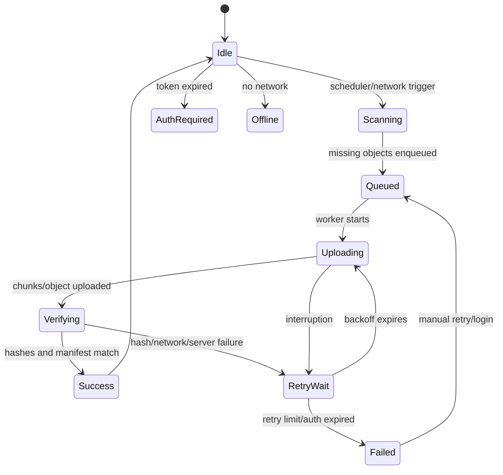
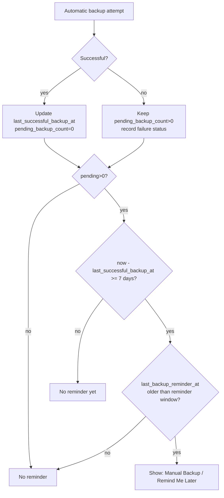

# RaceBrick Three-Tier Data Management and Synchronization Architecture

- Status: **Phase 1 draft for review**
- Date: 2026-11-26
- Scope: RaceBrick firmware, Android app, personal cloud server
- This document does **not** implement runtime behavior. It defines the target model before the phased rewrite.

---

## 1. Goals

1. RaceBrick records and races without a phone or Internet connection.
2. The Android app is the local-first user workspace and the only synchronization coordinator.
3. Track data supports three-way revisioned synchronization:
   `RaceBrick <-> App <-> Cloud`.
4. Session, Raw Telemetry, and Lap Records are immutable originals created by RaceBrick.
5. The app may only edit Track data. Session/lap/telemetry deletion or modification in the app is prohibited.
6. Device synchronization is explicit and selective. Connecting a device only performs read-only discovery and difference detection.
7. Cloud backup runs automatically in the background, incrementally and resumably, with a seven-day reminder when backups are pending.
8. Every track has a stable UUID and immutable revision history. Sessions reference the exact track revision used when recording.
9. All transfers are checksum-verified, restart-safe, and idempotent.
10. Legacy data remains viewable but is not mixed with canonical Race Log data.

## 2. Non-goals For Phase 1

- No changes to current runtime code yet.
- No database migration yet.
- No partial implementation of synchronization before this architecture is reviewed.
- No real-time cloud sync. Cloud is backup/restore, not a live racing dependency.
- No iOS implementation in this phase.

---

## 3. Current Baseline And Gaps

### 3.1 RaceBrick firmware

- Tracks are identified by external-flash slot (`store_slot`) and copied names. There is no stable UUID.
- Track storage is 256 x 4 KiB slots. A track's previous revisions are not stored.
- Session identity is `time(NULL)` seconds plus a 2 MiB slot. Collisions are possible.
- Sessions store `track_slot` and `track_name`, not a stable track revision ID.
- Raw samples are 16 bytes:
  `t_ms, lat_e7, lon_e7, speed10, lap, flags`.
  There is no per-sample GPS accuracy, satellite count, or IMU/sensor data.
- Raw samples have relative time only. Absolute time is reconstructed from `start_epoch`.
- Lap times live in the session header. Lap IDs and per-lap sector times do not exist.
- The 4 KiB session header has no telemetry chunk index or chunk hashes.
- Legacy `histrec_t` records remain separate and contain only best-lap traces.
- HTTP v1 has no pairing token, manifest, selective sync, chunk transfer, or resume.
- There are no tombstones or revision metadata for deleted sessions/laps.

### 3.2 Android app

- `SyncLocalDb` is a generic entity wrapper with UUID/revision/hash/dirty fields, not a typed Track/Session/Lap/Telemetry schema.
- `RaceActivity` reads the device directly and still exposes session/lap deletion actions that violate the new ownership rules.
- `LocalRecordsActivity` is a separate temporary local viewer; the target UI keeps local data in the RACE section.
- `LocalCache` and `SyncLocalDb` are duplicate storage paths.
- There are no Track Drafts, field-level modified state, batch commit, persistent transfer tasks, or conflict resolver.
- There is no typed local Track revision history or telemetry chunk storage.
- There is no WorkManager backup queue or seven-day backup reminder.
- The old cloud sync path uses full-snapshot replacement and must not be reused for the new protocol.

### 3.3 Cloud server

- Storage is currently Flask + SQLite + server filesystem.
- Tracks/sessions/logs are keyed by device-local slot/index, not stable UUIDs.
- There are no Track revision records, track revision references in sessions, Lap tables, or telemetry chunk tables.
- Sessions are uploaded as full CSV; there is no chunked/resumable transfer.
- There is no account-level backup task queue, restore workflow, or seven-day reminder.
- Direct device-to-cloud synchronization is disabled (`410`); the app relay remains the required path.

### 3.4 Data model gap summary

| Area | Current | Target |
|---|---|---|
| Track identity | flash slot / local integer | stable `track_id` UUID |
| Track history | current track only | immutable `track_revision` records |
| Session identity | epoch + slot | `session_id` UUID |
| Session track reference | slot + name copy | `track_id` + `track_revision_id` |
| Lap identity | array index | `lap_id` UUID |
| Sector times | best-only legacy data | per-lap sector times |
| Raw telemetry | fixed 16 B, relative time | versioned chunks, quality/aux fields |
| App edits | direct device calls | local Draft, atomic batch commit |
| Device sync | full/undifferentiated | manifest, diff, user-selected |
| Cloud backup | full snapshot | persistent incremental queue |
| Deletion | often physical/none | tombstones, explicit authorization |

---

## 4. Architecture Decisions

### AD-1: Local-first, offline-capable device

RaceBrick owns recording and timing. It never waits for the app or cloud for normal operation.

### AD-2: App is the synchronization coordinator

The device does not talk directly to the cloud. The app performs:

- device discovery and read-only manifest comparison;
- selective device import/export;
- Track Draft management and batch commit;
- persistent cloud backup and restore.

### AD-3: Ownership follows data type

- Track: three-way revisioned object, app-editable through Drafts.
- Session / Raw Telemetry / Lap Record: RaceBrick-created immutable originals, app read-only.
- App analysis: local derived data, never written back as original race data.

### AD-4: Stable IDs and immutable revisions

- Every Track has a UUID independent of name/slot.
- Every committed Track edit creates a new revision with UUID, parent, version, and content hash.
- Every Session references the exact Track revision active at recording start.
- Sessions/laps use stable IDs and immutable content hashes.

### AD-5: Explicit device sync, automatic cloud backup

- Device synchronization requires a difference report and explicit user selection.
- Cloud backup is automatic, incremental, background, retryable, and resumable.
- Automatic backup never edits Track data and never overwrites a local Draft.

### AD-6: Bounded device history, complete app/cloud history

- RaceBrick remembers the current Track revision plus a bounded set of prior revisions.
- The app and cloud retain complete Track revision history.
- Recommended device retention: current + 3 previous revisions per Track, with the limit configurable.
- If the device history limit is reached, a commit must not silently delete history. The app must archive the revision first, or the commit is rejected with `track_history_full`.

### AD-7: Protocol v2 over HTTP with explicit binary chunks

- JSON for metadata, manifests, and Track payloads.
- Binary chunk transfer for Raw Telemetry.
- BLE is used for discovery/status/pairing assistance where available; large data transfer uses Wi-Fi or USB.
- HTTP Range, SHA-256, idempotency keys, and explicit acknowledgments are mandatory.

### AD-8: Legacy Race Logs are read-only compatibility objects

- The canonical user-facing Race Log is the Raw RaceSession.
- Legacy `histrec_t` records remain under `Old Logs`, read-only, and are not converted into new Track/Session revisions.
- They may be backed up as legacy blobs but do not participate in the new lap/telemetry model.

### AD-9: Cloud storage starts modular, remains replaceable

- The existing Flask monolith and SQLite may be retained for the first implementation stage.
- All cloud data access goes through repository/storage interfaces so PostgreSQL and S3-compatible object storage can replace SQLite/filesystem without changing API contracts.
- This is an open decision for review; see Section 17.

---

## 5. Overall Architecture



### Data flow rules

1. RaceBrick -> App: user-selected Track/Session/Lap/Telemetry import.
2. App -> RaceBrick: Track Draft batch commit only.
3. App -> Cloud: automatic backup of committed Tracks, Sessions, Laps, Raw Telemetry.
4. Cloud -> App: user-selected restore/download, never an automatic overwrite.
5. RaceBrick -> Cloud directly: not allowed for business data.

---

## 6. Data Ownership And Permission Matrix

| Object | RaceBrick | App | Cloud | Rules |
|---|---|---|---|---|
| Track create | Yes | Draft/import only, explicit commit | Restore/import only | App may create a Draft from a Cloud Track; device validates final commit |
| Track read | Yes | Yes | Yes | All sides expose manifests |
| Track edit | Yes | Draft only, explicit batch commit | Revision restore/merge only | App must not write directly to device/cloud |
| Track delete | Yes, explicit | Request only with explicit authorization | Tombstone/restore | No cascading session deletion |
| Track history | Bounded | Full | Full | Sessions keep exact revision references |
| Session create | Yes | No | No | Device is sole origin |
| Session metadata | Yes | Read-only | Backup/restore | App cannot delete normal sessions |
| Session delete | Yes, explicit device UI | No | Tombstone only | App must not offer delete/overwrite |
| Raw Telemetry create | Yes | No | No | Device is sole origin |
| Raw Telemetry read/export | Yes | Yes | Yes | Chunked and checksummed |
| Raw Telemetry modify | No | No | No | Immutable |
| Lap create | Yes | No | No | Derived by device timing |
| Lap read/export | Yes | Yes | Yes | Read-only |
| Lap delete | Explicit device authorization | No | Tombstone only | Not a normal app operation |
| App analysis | N/A | Yes, separate table/files | Optional backup | Never merged into originals |
| Leaderboard publish | N/A | Manual selection | Validate/store | No automatic raw/private upload |

### Permission invariants

- The app has no write API for Session, Lap, or Raw Telemetry.
- A Track Draft is never an official Track revision.
- A deleted object is represented by a tombstone with revision metadata; hard deletion after retention is an explicit maintenance operation.
- Cloud restore into the app must create a new local working state and must not modify RaceBrick originals.

---

## 7. Unified Data Model

### 7.1 Core entities

#### Track

```text
track_id              UUID (immutable)
name                  string
location              JSON {label, lat, lon}
layout                JSON {points, closed, length_m}
track_geometry        JSON {type, points, width_m}   // centerline+width or polygon
start_finish_line     JSON {f, offset_m, width_m, heading, lat, lon}
sector_lines          JSON [{index, f, start, end}]
version               integer (latest committed version)
revision_id           UUID (latest revision)
content_hash          SHA-256
created_at            UTC timestamp
updated_at            UTC timestamp
deleted               bool
```

`track_geometry` is optional for existing tracks. When absent, consumers use the centerline plus `width_m` fallback. A missing boundary must be shown as “legacy geometry”, not synthesized silently.

#### TrackRevision

```text
track_id              UUID
revision_id           UUID
version               integer
parent_revision_id    UUID | null
payload               canonical Track JSON
content_hash          SHA-256
created_at            UTC
created_by            device | app | cloud
base_revision_id      UUID | null
```

#### Session

```text
session_id            UUID
track_id              UUID
track_revision_id     UUID       // exact revision used while recording
track_version         integer
device_id             string     // hardware UID, e.g. esp32s3-32D0A8
start_time            UTC
end_time              UTC
session_type          race | practice | test
total_laps            integer
best_lap_time_ms      integer
metadata              JSON {vehicle, track_condition, weather, notes, fw, ...}
raw_available         bool
metadata_hash         SHA-256
laps_hash             SHA-256
telemetry_hash        SHA-256 | null
deleted               bool
```

#### RawTelemetry

Raw telemetry is stored as immutable chunks, not one database row per sample.

```text
session_id            UUID
format_version        integer
sample_rate_hz        integer
sample_count          integer
start_time            UTC
chunks                [{chunk_id, seq, offset, size, sha256}]
```

Proposed v3 sample fields:

```text
t_ms                  uint32 (relative to session start)
lat_e7                int32
lon_e7                int32
speed_cmh             uint16 (0.01 km/h or documented unit)
gps_accuracy_cm       uint16 (0xFFFF = unavailable)
satellites            uint8
fix_type              uint8
lap                   uint8
flags                 uint8
```

Base size is 20 bytes. At 25 Hz this is about 70 minutes per 2 MiB session slot, versus 87 minutes today. Optional IMU/auxiliary streams are separate chunks so they do not silently change the GPS sample format.

Canonical absolute timestamp is `session.start_time + t_ms`. The app must not invent UTC when the device has no valid time source; session metadata records `time_source` and `time_uncertainty_ms`.

#### LapRecord

```text
lap_id                UUID (UUIDv5 of session_id + lap_number is acceptable)
session_id            UUID
lap_number            integer
lap_time_ms           integer
sector_times_ms       [integer]
start_timestamp       UTC
end_timestamp         UTC
best_lap              bool (derived; not editable)
telemetry_reference   {first_sample, last_sample, chunk_ids}
content_hash          SHA-256
deleted               bool
```

#### TrackDraft

```text
track_id              UUID
base_revision_id      UUID
base_data             canonical Track JSON
draft_data            canonical Track JSON
modified_fields       [string]
draft_status          editing | pending | syncing | conflict | failed
created_at            UTC
updated_at            UTC
```

#### SyncMetadata

Keep separate device and cloud state:

```text
object_id             UUID
object_type           track | session | lap | telemetry
local_version         integer
racebrick_version     integer | null
cloud_version         integer | null
local_hash            SHA-256
racebrick_hash        SHA-256 | null
cloud_hash            SHA-256 | null
sync_status           clean | dirty_device | dirty_cloud | conflict | deleted
last_synced_at        UTC
```

#### SyncTask

```text
task_id               UUID
task_type             track_commit | track_import | session_import |
                      telemetry_download | cloud_backup | cloud_restore
object_id             UUID
source                device | app | cloud
destination           device | app | cloud
status                pending | running | waiting_retry | done | failed | cancelled
retry_count           integer
idempotency_key       UUID
created_at            UTC
updated_at            UTC
error_message         string | null
```

#### AppAnalysis

Derived data keyed separately from originals:

```text
analysis_id           UUID
session_id            UUID
analysis_type         speed | lap_compare | sector_compare | summary
data                  JSON
created_at            UTC
```

### 7.2 Relationship diagram



### 7.3 Device storage mapping

External W25Q128, 16 MiB, current allocation:

```text
0x000000 - 0x0FFFFF   256 x 4 KiB   Tracks
0x100000 - 0xEFFFFF     7 x 2 MiB   Sessions
0xF00000 - 0xFFFFFF   256 x 4 KiB   Legacy logs
```

Proposed use:

- Track slot stores one immutable Track revision, keyed by `(track_id, revision_id)`.
- Track directory/manifest is reconstructed by scanning valid slots, but each slot contains stable UUIDs and version metadata.
- Recommended device retention: current + 3 previous revisions per Track. Full history lives in App and Cloud.
- Session header v3 includes:
  `session_id`, `track_id`, `track_revision_id`, UTC start/end, Lap Records, telemetry chunk table/hashes, format version.
- Raw telemetry remains inside the session slot, split into logical 64 KiB chunks; chunk hashes are stored in the 4 KiB header.
- Lap sector data: up to 16 laps x 8 sectors. Existing sessions report empty sector arrays, not fabricated values.
- Legacy `histrec_t` storage remains untouched and read-only.

### 7.4 Android database

Replace the generic `entities` table with typed tables. Suggested schema:

```text
tracks
track_revisions
track_drafts
sessions
lap_records
telemetry_chunks
sync_metadata
sync_tasks
backup_state
app_analysis
legacy_logs
```

Files:

- Telemetry chunks are content-addressed files, e.g.
  `filesDir/sync_blobs/sha256/<hash>`.
- Track geometry/other large assets use content-addressed files or blobs.
- A migration may use the existing generic `entities` table as an import staging area, but no new business logic may depend on it.

### 7.5 Cloud schema

Minimum tables:

```text
users, auth_tokens, devices
tracks, track_revisions
sessions, lap_records, telemetry_chunks
sync_state, backup_jobs, backup_objects, backup_reminders
leaderboard_entries, audit_log
```

Required invariants:

- All rows are scoped by owning user/device.
- Track revisions are immutable and unique by `(track_id, revision_id)`.
- Track Drafts stay on the app and are never stored as cloud revisions.
- Telemetry chunks are immutable and addressed by SHA-256.
- Cloud never silently accepts a revision whose `base_revision_id` does not match the current head.
- Cloud never modifies Session/Lap/Raw content.

### 7.6 Canonicalization and hashes

- Metadata and Track payloads use a documented canonical JSON encoding (RFC 8785/JCS or an equivalent fixed implementation).
- Large binary data uses SHA-256 over the exact bytes.
- Track `content_hash` covers the canonical Track payload including geometry, start line, and sectors.
- Session `laps_hash` covers all lap records; `telemetry_hash` covers the concatenated chunk hashes.
- Hash validation happens before acknowledging a transfer.

---

## 8. Three-Way Track Synchronization



### Rules

1. The App compares Track `version`, `revision_id`, and `content_hash` before any transfer.
2. Cloud is not assumed newest.
3. A Track Draft is not a committed revision and never participates in device commit or cloud backup.
4. If the target head differs from the Draft's base revision, the commit is rejected with a conflict.
5. A committed Track revision is immutable. Corrections create a new revision.
6. Sessions keep the `track_revision_id` used at recording; editing a Track later never rewrites history.
7. Deleting a Track does not delete Sessions/Laps. They retain the original Track reference and display a “deleted track” label.
8. Restoring an old Track revision creates a new head revision with `parent_revision_id` pointing to the current head, not an in-place rewrite.

### Track history behavior

| Location | Current | History |
|---|---|---|
| RaceBrick | required | bounded, default 4 revisions |
| App | required | full |
| Cloud | required | full |

When device history is full, the app must archive/backup the old revision before the device may evict it. No silent eviction is allowed.

---

## 9. RaceBrick-App Discovery And Difference Detection

Connecting to RaceBrick retrieves a read-only manifest. It does **not** automatically transfer, delete, or modify business data.



### Difference categories

Track:

- local only
- device only
- same revision/hash
- local Draft pending
- device newer
- both changed since base -> conflict
- one side deleted -> deletion conflict

Session:

- device only
- app local copy missing metadata
- raw telemetry missing
- local hash mismatch (corruption; retry, never treat as an edit)
- device deletion tombstone

Lap:

- included with Session metadata package
- missing/corrupt separately
- never locally editable

### 9.1 Synchronization dialog specification

Tracks section:

```text
[ ] Track name
    UUID: xxxxxxxx...
    RaceBrick: v12  hash abcd...
    App:       v11  hash efgh...
    Direction: RaceBrick -> App
    State: modified
```

Sessions section:

```text
[ ] Session 2026-11-26 14:03
    Track: Shanghai Kart / revision v7
    Laps: 12   Best: 00:42.318
    Basic package: metadata + lap records (selected)
    Raw telemetry: 28.4 MB [available] (separate checkbox)
```

Dialog requirements:

- Select All / Deselect All for Tracks and Sessions independently.
- Each Track has an independent checkbox and direction.
- Each Session has an independent checkbox.
- Raw telemetry has a separate checkbox per selected Session.
- Show selection count and estimated transfer size.
- Show conflict items separately and disable unsafe direction choices until resolved.
- Cancel changes nothing.
- Failed objects remain selected and retryable; successful objects are not transferred again.
- No unnecessary confirmation dialog when both sides are synchronized.

### 9.2 Transfer protocol behavior

1. App requests selected Track revisions, Session metadata, and Lap records.
2. Device returns data with content hashes.
3. App verifies and commits to its local DB/file storage.
4. For raw telemetry, app requests the chunk manifest, then each missing chunk with Range/resume support.
5. App verifies chunk SHA-256 and the final telemetry hash.
6. App calls the device acknowledgment endpoint.
7. App updates `SyncMetadata` only after verification.
8. Interrupted downloads resume from the last verified chunk.

No raw telemetry is downloaded as part of the basic Session package unless selected.

---

## 10. Track Editor: Draft And Batch Commit

### 10.1 Draft state machine



### 10.2 Editor requirements

- Load latest committed Track, record `base_revision_id` and base data.
- Create/persist a Draft on the first modification.
- Track modified fields individually.
- Yellow border around every modified field.
- Top bar shows:
  - no pending change: no active Sync button;
  - pending: `SYNC (N)`;
  - syncing: progress;
  - success: modified indicators cleared;
  - failure/conflict: Draft preserved.
- Support reverting one field, discarding all, and surviving app restart.
- Do not allow editing Sessions/Laps/Raw data.

### 10.3 Batch commit protocol

```mermaid
sequenceDiagram
    participant U as User
    participant A as App DraftManager
    participant D as RaceBrick
    participant C as Cloud queue

    U->>A: Click Sync
    A->>A: Compare draft vs committed; build full payload
    A->>D: GET track head version/revision
    alt head != base_revision_id
        A-->>U: Conflict; preserve Draft
    else head matches
        A->>D: POST /api/v2/tracks/commit<br/>idempotency key + base_revision_id + payload
        D->>D: Validate, allocate revision, atomic write
        D-->>A: new revision_id, version, content_hash
        A->>A: Verify hash; update committed data
        A->>A: Clear only the fields included in this commit
        A->>C: Enqueue committed revision for cloud backup
        A-->>U: Success or per-field failure
    end
```

If the response is lost, the app retries the same idempotency key; the device returns the already committed result. If the user edits while syncing, the new Draft generation is stored separately and is not cleared by the older acknowledgment.

---

## 11. Cloud Backup And Seven-Day Reminder

Cloud backup is independent of device synchronization and is automatic in the background.

### 11.1 Backup state machine



### 11.2 Backup scope

Automatically back up:

- committed Track revisions and the current Track head;
- Session metadata;
- Lap Records;
- Raw Telemetry chunks;
- relevant user settings.

Never back up:

- uncommitted Track Drafts as official revisions;
- temporary caches;
- partial downloads;
- app-only throwaway files.

### 11.3 Incremental and resumable rules

- Initial backup: manifest of all objects, then missing objects/chunks.
- Incremental backup: compare local manifest to cloud manifest by object ID/version/hash.
- Each object has an idempotency key.
- Chunks are content-addressed and only uploaded once.
- Verify object hash and final manifest before marking success.
- Persist task state across app restarts.
- Use WorkManager/foreground service for large transfers.

### 11.4 Seven-day reminder workflow



Store:

- `last_successful_backup_at`
- `pending_backup_count`
- `last_backup_reminder_at`
- `backup_failure_status`

Reminder rules:

1. Attempt backup when appropriate, not only when the user opens the app.
2. Retry transient failures with exponential backoff.
3. Show a reminder only when a successful backup has not occurred for seven days **and** pending backup data exists.
4. Offer Manual Backup and Remind Me Later.
5. Clear completed tasks only after server acknowledgment and verification.
6. No reminders when there is no pending data.

### 11.5 Restore

- Restore is user-initiated and previewed.
- Never silently overwrite local data.
- Show object counts, versions, sizes, and conflicts.
- Restore writes to app-local storage only; it does not write to RaceBrick.
- Restoring a Track revision creates a new Track head locally and can be pushed to the device only through the normal Draft/commit flow.

---

## 12. Conflict Resolution Strategy

### 12.1 Track conflicts

A conflict exists when:

- draft base revision != target device head; or
- app/cloud track heads have different `revision_id`/hash but a shared base; or
- one side deleted and the other modified; or
- the same version number has different content hashes.

Resolution UI:

```text
Track: Shanghai Kart
Base:    v6  hash 1111
Local:   v7  hash 2222   [Draft]
Device:  v7  hash 3333   [Device]
Cloud:   v6  hash 1111

[Keep Local] [Use Device] [Use Cloud] [Manual Merge]
```

Rules:

- Never overwrite automatically.
- Preserve the Draft and all three payloads.
- Compare fields; show changed fields side by side.
- Manual merge creates a new Draft based on the chosen head.
- Commit with `base_revision_id` of the resolved head.
- A deleted Track vs modified Track is always a conflict; no cascade delete of Sessions.
- Sessions that reference a deleted Track remain readable and show a deletion marker.

### 12.2 Immutable data conflicts

- Session/Lap/Raw Telemetry cannot conflict as editable objects.
- A hash mismatch is corruption or an incomplete transfer, not a merge case.
- Retry the chunk/object; quarantine it after repeated failure.
- The app must never patch an original to make a hash match.

---

## 13. Protocol And API Specification

Detailed wire contracts are in [API_V2.md](API_V2.md).

### 13.1 Device protocol v2 summary

- Discovery: existing UDP discovery, upgraded with protocol/device ID.
- Pairing: one-time code, device-issued token, token stored in Android Keystore.
- Manifest: read-only inventory of Tracks/Sessions/Laps/Telemetry.
- Track commit: idempotent atomic batch with `base_revision_id`.
- Session/Lap: read-only downloads.
- Raw Telemetry: chunk manifest, HTTP Range, SHA-256, resume.
- No Session/Lap/Raw write endpoint exposed by the app protocol.
- Device blocks writes while racing.

### 13.2 Cloud protocol v2 summary

- Auth and device ownership.
- Track revision upload/download/restore with `If-Match`/409.
- Session/Lap metadata upload (immutable).
- Telemetry chunk upload/restore.
- Backup job/manifest/status/reminder APIs.
- Account-level isolation for every object.
- Manual leaderboard endpoint separate from private backup APIs.

### 13.3 Idempotency and errors

- Mutating requests carry `Idempotency-Key`.
- Version-safe writes use `If-Match` or `base_revision_id`.
- Standard errors:
  - `400` invalid payload;
  - `401` unauthenticated;
  - `403` wrong owner;
  - `404` missing object;
  - `409` version conflict / race active;
  - `412` precondition failed;
  - `413` chunk too large;
  - `416` invalid range;
  - `429` rate limited;
  - `5xx` retry with backoff.

---

## 14. Cloud Backend Modules, Reliability, And Leaderboard

### 14.1 Modular monolith

The cloud starts as one deployable Flask service, but code must be split into explicit modules:

```text
Cloud
├── AuthService
├── UserService
├── DeviceService
├── TrackService
├── SessionService
├── LapService
├── BackupService
├── SyncService
└── LeaderboardService
```

| Module | Responsibility |
|---|---|
| AuthService | register/login/token/refresh/revocation |
| UserService | account profile and isolation |
| DeviceService | device ownership, pairing metadata, manifests |
| TrackService | Track heads, immutable revisions, restore, conflicts |
| SessionService | immutable Session metadata and tombstones |
| LapService | immutable Lap Records and validation |
| BackupService | backup jobs, object manifests, chunks, restore preview/execution |
| SyncService | idempotency records, persistent tasks, acknowledgments, retries |
| LeaderboardService | manual publication, validation, public ranking queries |

Rules:

- Route handlers call services; they do not directly manipulate tables or files.
- Storage access is behind repository/blob interfaces.
- Every table or object operation is scoped by owner account and device.
- Cloud never writes back to RaceBrick; it only serves the app.

### 14.2 Reliability requirements

- Track revision writes are transactional and unique by `(track_id, revision_id)`.
- Session/Lap/Telemetry objects are immutable after verification.
- Telemetry chunks are content-addressed and written atomically (temporary file + fsync + rename or object-store equivalent).
- Every mutation records an idempotency key and result.
- Deletions create tombstones; no accidental cascade deletion.
- Queue states and retries survive process restart.
- Checksums are verified before success is recorded.
- Database and blob-store consistency is repairable by manifest reconciliation.
- No endpoint silently overwrites a newer revision.

### 14.3 Leaderboard and public sharing

Publishing is separate from backup and device sync.

1. User selects Track, exact Track revision, Session, Lap, and vehicle class.
2. The app creates a public payload with only the required fields.
3. Cloud validates:
   - ownership;
   - Session/Lap/Track revision hashes;
   - lap time and sector times;
   - track layout revision and vehicle class.
4. Rank is keyed by `(track_id, track_revision_id, vehicle_class, lap_time_ms)`.
5. Raw telemetry, notes, and private backup data are excluded by default.
6. Withdrawal creates a tombstone for the public entry only; original race data is unaffected.

### 14.4 Per-phase file plan

| Phase | Main files |
|---|---|
| 2 | firmware `tstore.*`, `race_store.*`, `sim.h`, `app.h`; app `SyncLocalDb` replacement, local DB migration; server schema/repositories |
| 3 | firmware `netcfg.*` manifest/chunk endpoints; app `DeviceSyncManager`, `DeviceDifferenceDetector`, sync UI; protocol tests |
| 4 | firmware atomic Track commit; app `TrackDraftManager`, `TrackEditor`, `ConflictResolver`; server Track revision APIs |
| 5 | app `BackupManager`, WorkManager workers, `BackupReminderManager`; server backup/sync services and storage |
| 6 | app `LapAnalysis`, `DataExportManager`, telemetry viewer; server LeaderboardService |

Each runtime phase must include unit tests, integration tests against a real device/emulator, and failure-recovery tests listed in Section 16.

## 15. App Module Boundaries

The UI must not call transport or cloud APIs directly.

```text
Android
├── TrackManager
├── TrackDraftManager
├── TrackEditor
├── SessionManager
├── TelemetryViewer
├── LapAnalysis
├── DataExportManager
├── LocalDatabase
├── LocalFileStorage
├── DeviceCommunicationManager
├── DeviceDifferenceDetector
├── DeviceSyncManager
├── CloudSyncManager / BackupManager
├── BackupReminderManager
├── PersistentTaskQueue
├── ConflictResolver
└── RACE UI
```

Planned migration from current files:

- `SyncLocalDb` -> typed `LocalDatabase` schema/migrations, with generic table retired after migration.
- `LocalRecordsActivity` -> merge local Tracks/Race Logs into `RaceActivity`; remove standalone local page.
- `SyncActivity` -> status, difference/sync dialog, backup status; no local data browsing.
- `RaceApi` -> `DeviceProtocolV2`; v1 retained only for migration/fallback.
- `CloudClient`/`CloudSyncManager` -> v2 backup/restore manager; remove full-snapshot replacement path.
- `RaceActivity` -> local-first RACE UI; read-only Sessions/Laps; Track Draft editing.
- `LocalCache` -> migrate into typed local DB; remove duplicate snapshot model.

---

## 16. Implementation Roadmap And Per-Phase Tests

### Phase 1: Architecture and data model

Deliverables:

- This document and `API_V2.md`.
- Permission matrix, ER model, manifests, draft/commit/backup state machines.
- Review and approval before runtime changes.

Exit criteria:

- Approval of open decisions.
- No runtime code changed.

### Phase 2: Local data management

Work:

- Firmware v3 Track/Session/Lap/Telemetry records and UUIDs.
- App typed database and migration.
- App content-addressed telemetry storage.
- Device and app manifest generation.
- Server v2 schema migration.

Tests:

- UUID stability across reboot/reflash where expected.
- Track revision hash stability across languages.
- Session references fixed Track revision.
- Legacy data migration does not mutate originals.
- Corrupt flash/header handling.

### Phase 3: RaceBrick-App synchronization

Work:

- Pairing/discovery.
- Manifest comparison and difference report.
- Selectable Tracks/Sessions.
- Independent raw telemetry selection.
- Chunked/resumable transfer with verification.
- Per-object retry and acknowledgments.

Tests:

- No differences -> no transfer dialog.
- Cancel changes nothing.
- Unselected objects untouched.
- Interrupted transfer resumes.
- Hash mismatch retried/quarantined.
- No session/lap write path exists.

### Phase 4: Track editing and batch commit

Work:

- Draft persistence and field-level modified state.
- Yellow modified-field UI.
- Top Sync action.
- Device atomic batch commit.
- Conflict detection/resolution.
- Draft survives failures/restart; new edits during sync preserved.

Tests:

- Stale `base_revision_id` -> 409, no write.
- Lost response + retry -> no duplicate revision.
- Partial validation failure -> no commit.
- Session track revision remains unchanged.
- Device history-full rejection.

### Phase 5: Cloud integration and backup

Work:

- V2 auth/device APIs.
- Track revision upload/restore.
- Session/lap/telemetry backup.
- Persistent backup queue.
- Background scheduling and seven-day reminder.
- Restore preview.

Tests:

- Incremental backup uploads only missing objects.
- Resume after network interruption.
- Token expiry keeps queue.
- No reminder without pending data.
- Seven-day reminder exact boundary.
- Restore never overwrites without confirmation.
- Account isolation.

### Phase 6: Analysis and publishing

Work:

- Local speed/lap/sector analysis.
- Telemetry visualization and export.
- Manual leaderboard publish.
- Public payload excludes private raw data by default.

Tests:

- Analysis is separate from original data.
- Leaderboard validation rejects invalid lap/sector/track version.
- Raw telemetry never auto-published.

### Push checkpoints

- Phase 1: documentation only.
- Phase 2: schema/storage only, no sync UI.
- Phase 3: device-app sync, no cloud backup.
- Phase 4: Track drafts/commit, no cloud auto backup.
- Phase 5: cloud backup/restore.
- Phase 6: analysis/publishing.

Each phase must pass build/tests on firmware, Android, and server before the next phase.

---

## 17. Open Decisions For Review

1. **Cloud storage**: keep Flask + SQLite + filesystem for Phase 5, with repository interfaces, or migrate to PostgreSQL + S3-compatible storage immediately?
   - Recommendation: keep SQLite/filesystem for the first implementation, isolate storage behind interfaces, migrate only when scale requires it.
2. **Device Track history depth**: recommended current + 3 previous revisions (4 total) per Track. Is that sufficient?
3. **Telemetry v3 sample size**: 20-byte samples preserve GPS accuracy/satellite fields at 25 Hz but reduce per-slot duration to about 70 minutes. Acceptable, or prefer a separate auxiliary accuracy stream?
4. **Track geometry editor scope**: centerline + width + start/sector lines first, or full boundary polygon editing from day one?
5. **Pairing**: use a one-time code/token for device sync, while retaining the AP password? Any requirement for BLE-only pairing?
6. **Legacy histrec**: keep read-only under Old Logs and exclude from canonical sync; confirm.
7. **Automatic cloud backup vs earlier no-auto policy**: this document follows the new requirement for automatic backup (not automatic device sync). Confirm.
8. **Session timestamps**: standardize on GNSS UTC plus time-source/uncertainty metadata; confirm devices without a fix use an explicit unknown-time state rather than local fake time.

---

## 18. Review Checklist

- [ ] Ownership and permission matrix accepted.
- [ ] Track UUID/revision/history model accepted.
- [ ] Session references exact Track revision accepted.
- [ ] Raw telemetry chunk/sample format accepted.
- [ ] Device manifest and selective sync dialog accepted.
- [ ] Draft and batch commit protocol accepted.
- [ ] Cloud automatic backup and seven-day reminder accepted.
- [ ] Conflict policy accepted.
- [ ] API v2 accepted.
- [ ] Roadmap/phase boundaries accepted.
- [ ] Open decisions resolved.
